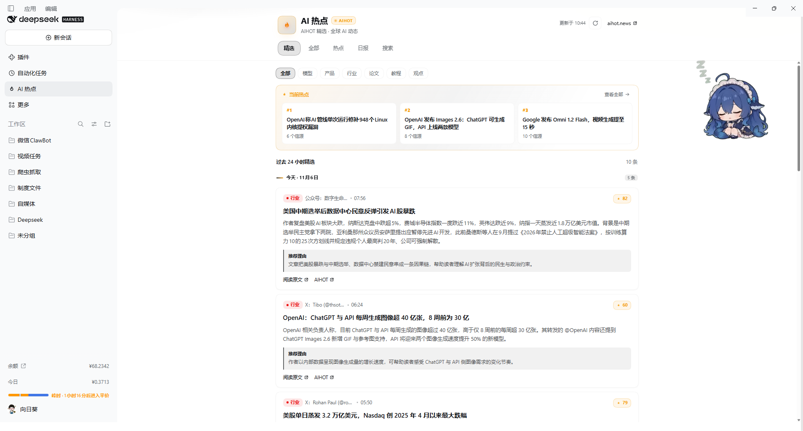
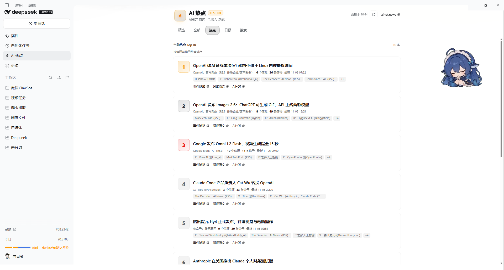
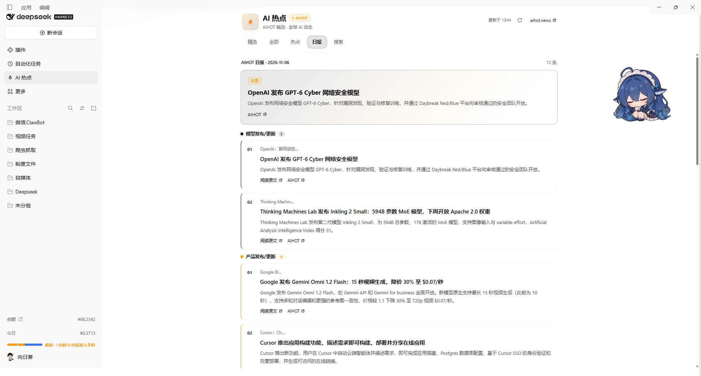
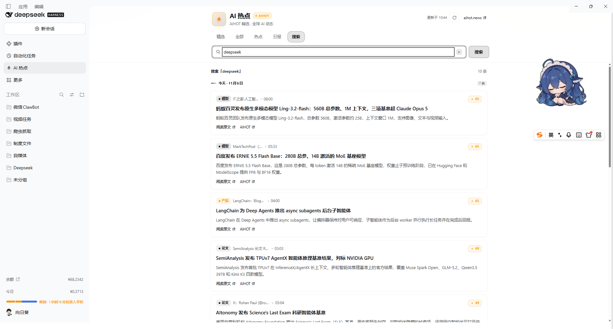

# dsh-aihot

> AI news in the DeepSeek Harness sidebar: **24-hour picks, recent stories, a trending board, the daily digest and keyword search** — all from [AIHOT](https://aihot.news/), with category filters, date grouping and endless scroll.

**English** | [中文](./README_ZH.md) · [Screenshots](#screenshots) · [Install](#installation) · [Features](#features)

[](LICENSE)

A [DeepSeek Harness (DSH)](https://github.com/deepseek-ai/deepseek-harness) client plugin. It adds a **AI trending** row to the left sidebar and a full page with five tabs backed by the public AIHOT JSON API. No API key, no server half, no build step.

## Screenshots



**Picks** — category pills, the trending rail, and cards grouped by day.

| Trending board | Daily digest |
| --- | --- |
|  |  |



**Search** — full-text search over the last seven days; **Load more** keeps appending, ten stories at a time.

## Installation

### DSH Desktop (plugin manager)

Open **Plugins** (插件) in the sidebar → **Add plugin** (添加插件) → enter the package name:

```text
dsh-aihot
```

Pick an install source that works on your network and click **Install**. When it finishes, `dsh-aihot` appears under **Installed** — make sure its switch is on, then restart DSH Desktop (including its tray process) if the sidebar row does not show up.

### From the command line

```bash
dsh plugin --profile desktop add dsh-aihot
```

Restart the host afterwards, then reload the window. The sidebar shows **AI 热点** / **AI trending** under *Automation* (自动化任务).

<details>
<summary>Install from this repository instead</summary>

```bash
git clone https://github.com/liunianlh/dsh-aihot.git
dsh plugin --profile desktop add ./dsh-aihot
```

The package declares `dsh.bundle.patch`, so the plugin manager picks it up automatically — no extra flags.

</details>

## Features

| Tab | What it shows |
| --- | --- |
| **Picks** (精选) | Stories AIHOT selected in the last 24 hours, plus a three-card trending rail on top |
| **All** (全部) | Everything AIHOT collected in the last 7 days |
| **Trending** (热点) | The current top-ten board, ranked by source and signal heat |
| **Daily** (日报) | The latest daily digest: one lead story, then themed sections |
| **Search** (搜索) | Keyword search across the last 7 days |

| Detail | Behavior |
| --- | --- |
| Category filter | Models, products, industry, papers, guides, opinion — on the *Picks* and *All* tabs |
| Endless scroll | Ten stories per page over a cursor; the next page loads automatically as you approach the bottom, with a **Load more** button as a fallback |
| Date grouping | Stories are bucketed by **Asia/Shanghai** day and labeled *today* / *yesterday* |
| Cards | Category badge, source, publish time, heat score, summary, AIHOT's recommendation note, and links to the original article and to AIHOT |
| Refresh | Manual refresh button; a background refresh every 5 minutes, skipped when the page is hidden or you have scrolled down |
| Appearance | Colors come from the host's `--dsw-alias-*` theme tokens, so the panel follows light and dark themes |
| Languages | Chinese and English, following the host locale toggle |

## Data source

All content comes from `https://aihot.news/api/v1` — the public JSON API of the AIHOT news site:

| Endpoint | Used for |
| --- | --- |
| `GET /items?mode=selected&window=24h` | Picks |
| `GET /items?mode=all&window=7d` | All stories, and search with `q=` |
| `GET /hot-topics` | Trending board |
| `GET /dailies/latest` | Daily digest |

Request-specific limits and cursors are passed through the query string. The plugin only reads; it sends nothing but the search keyword you type. AIHOT is a third-party service — if its API changes shape, the panel can only show the failure state until this plugin is updated.

## Notes and limitations

- The panel is read-only: no settings page, no local storage, no telemetry.
- Everything is fetched client-side from the browser, so the network must reach `aihot.news`; behind a restrictive proxy the panel shows a retry state.
- Story text stays in the language AIHOT publishes it in. The Chinese/English switch covers the plugin's own interface strings, not the news content.
- Times are rendered in Beijing time regardless of the host's locale, matching AIHOT's day grouping.

## Development

```bash
node --check client.js   # the browser bundle is a single plain-JS file
```

`client.js` is loaded by the host as a module bundle: `window.__ModuleLoader__.load({ id: 'dsh-aihot', factory(require) })`. Its `id` must stay equal to the package name. `index.js` only exports an empty host half; `cordis.patch.yml` registers the bundle.

## License

[MIT](LICENSE)
