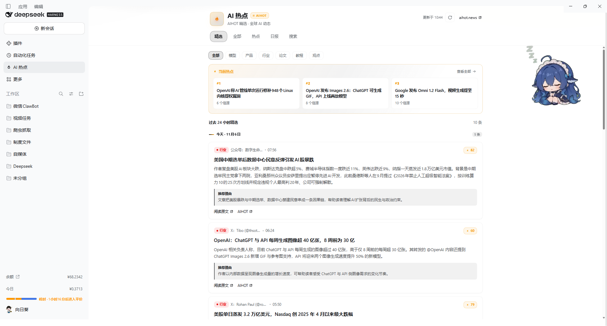
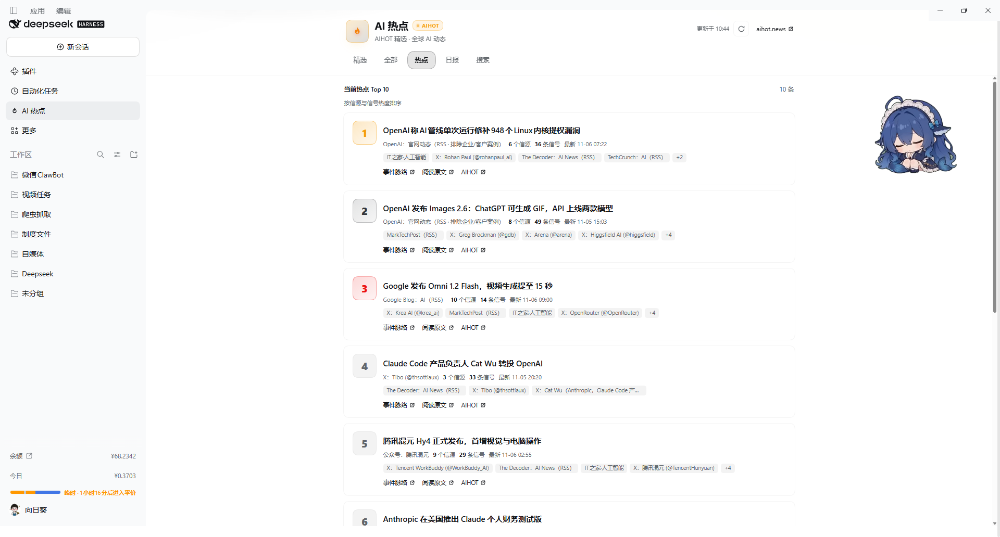
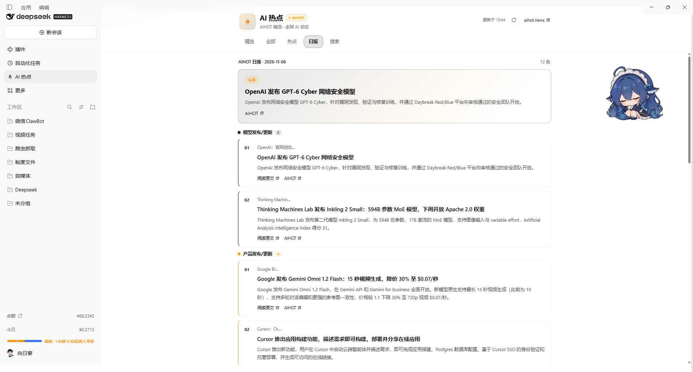
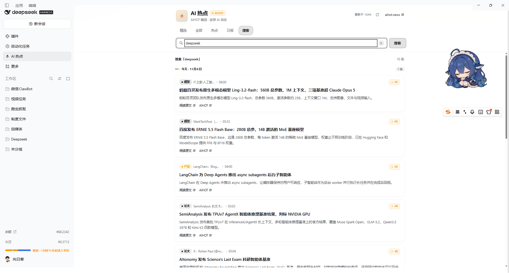

# dsh-aihot

> 把 AI 热点塞进 DeepSeek Harness 左侧栏：**24 小时精选、最近动态、热点榜、日报与关键词搜索**，数据来自 [AIHOT](https://aihot.news/)，支持分类筛选、按日分组与滚动加载。

[English](./README.md) | **中文** · [截图](#截图) · [安装](#安装) · [功能](#功能)

[](LICENSE)

这是一个 [DeepSeek Harness (DSH)](https://github.com/deepseek-ai/deepseek-harness) 客户端插件。它在左侧栏新增一行 **AI 热点**，并提供一个五标签的完整页面，数据直接取自 AIHOT 的公开 JSON API。不需要 API Key，没有服务端，也没有构建步骤。

## 截图



**精选** —— 分类筛选、热点 rail，卡片按日分组。

| 热点榜 | 日报 |
| --- | --- |
|  |  |



**搜索** —— 最近 7 天全文检索；**加载更多**每次追加十条。

## 安装

### DSH 桌面端（插件管理器）

左侧栏打开 **插件** → 右上角 **添加插件** → 在「包名或地址」里填写：

```text
dsh-aihot
```

选一个你网络可用的安装源，点击 **安装**。完成后 `dsh-aihot` 会出现在「已安装」列表，确认开关是开启状态；如果侧边栏没有出现新入口，完全退出桌面端（包括托盘进程）再打开。

### 命令行

```bash
dsh plugin --profile desktop add dsh-aihot
```

安装后重启宿主并刷新窗口，侧边栏「自动化任务」下方会出现 **AI 热点**。

<details>
<summary>从本仓库安装</summary>

```bash
git clone https://github.com/liunianlh/dsh-aihot.git
dsh plugin --profile desktop add ./dsh-aihot
```

包内已声明 `dsh.bundle.patch`，插件管理器会自动识别，无需额外参数。

</details>

## 功能

| 标签 | 内容 |
| --- | --- |
| **精选** | AIHOT 最近 24 小时精选，顶部另有三张卡片的热点 rail |
| **全部** | 最近 7 天 AIHOT 收录的全部动态 |
| **热点** | 当前 Top 10 榜，按信源与信号热度排序 |
| **日报** | 最新一期日报：一条头条，然后按主题分组 |
| **搜索** | 最近 7 天关键词检索 |

| 细节 | 行为 |
| --- | --- |
| 分类筛选 | 模型、产品、行业、论文、教程、观点 —— 作用于「精选」与「全部」 |
| 滚动加载 | 基于 cursor，每页 10 条；接近底部自动加载下一页，并以「加载更多」按钮兜底 |
| 按日分组 | 按 **Asia/Shanghai** 时区切日，标注「今天」/「昨天」 |
| 卡片 | 分类彩标、信源、发布时间、热度分、摘要、AIHOT 推荐理由，以及原文与 AIHOT 两条链接 |
| 刷新 | 手动刷新按钮；每 5 分钟后台刷新一次，页面隐藏或已向下滚动时跳过 |
| 外观 | 颜色全部取自宿主的 `--dsw-alias-*` 主题变量，跟随亮色/暗色主题 |
| 语言 | 中英文，跟随宿主语言开关 |

## 数据来源

所有内容来自 `https://aihot.news/api/v1`，即 AIHOT 新闻站的公开 JSON API：

| 接口 | 用途 |
| --- | --- |
| `GET /items?mode=selected&window=24h` | 精选 |
| `GET /items?mode=all&window=7d` | 全部动态；带 `q=` 时为搜索 |
| `GET /hot-topics` | 热点榜 |
| `GET /dailies/latest` | 日报 |

每页条数与翻页游标通过查询参数传递。插件只做读取，除了你输入的搜索词外不发送任何内容。AIHOT 是第三方服务，若其接口结构变化，本插件在更新前只能显示失败状态。

## 说明与限制

- 面板是只读的：没有设置页、没有本地存储、没有埋点上报。
- 数据在浏览器端直接请求，因此网络需要能访问 `aihot.news`；在受限代理下会显示重试状态。
- 正文语言与 AIHOT 发布时一致；中英文开关只影响插件自身的界面文案，不翻译新闻内容。
- 时间统一按北京时间渲染，与 AIHOT 的按日分组保持一致。

## 开发

```bash
node --check client.js   # 浏览器产物是一个纯 JS 文件
```

`client.js` 由宿主以模块包形式加载：`window.__ModuleLoader__.load({ id: 'dsh-aihot', factory(require) })`，其中 `id` 必须与包名一致。`index.js` 只导出一个空的宿主侧实现；`cordis.patch.yml` 负责注册该包。

## 许可证

[MIT](LICENSE)
